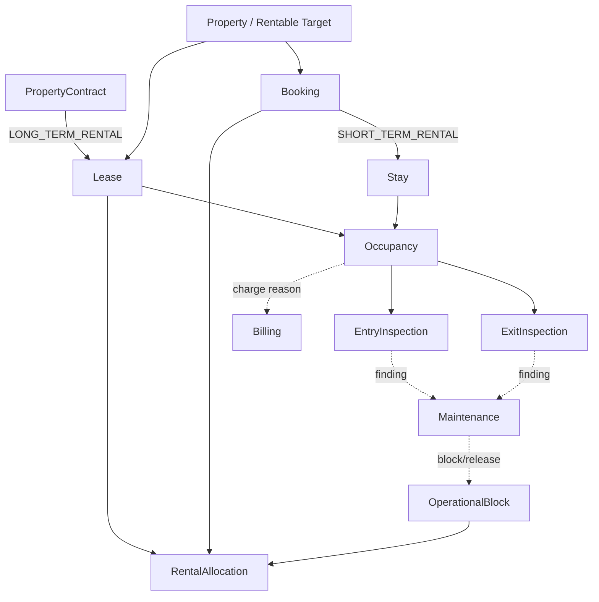

# Rental Operations

## Purpose

Rental Operations owns tenant-scoped operational execution after a rental commitment. `LONG_TERM_RENTAL` and `SHORT_TERM_RENTAL` are first-class modes.

## Ownership

Rental Operations Team owns this bounded context, its data, migrations, contracts and operational invariants.

## Implemented foundation

- `Lease` operationalizes an existing active Property `PropertyContract` without duplicating its legal lifecycle.
- `Booking` is the distinct short-term commitment; `Stay` executes a Booking.
- `Occupancy` records operational use and explicitly originates from one Lease or one Stay.
- `PropertyInspection` supports `ENTRY` and `EXIT` for both rental modes.
- `RentalAllocation` represents a temporal claim from one Lease, Booking or OperationalBlock.
- `OperationalBlock` excludes a rentable target without creating a fake Lease or Booking.
- PostgreSQL tables use `tenant_id`, tenant-scoped keys, explicit provenance constraints and forced RLS.

Property identity and hierarchy remain owned by Property Management. Rentable-target and PropertyContract identifiers are validated through future explicit ports; cross-service database foreign keys are intentionally absent.

## Domain map

## Boundaries

- Property Management owns assets, hierarchy, publication, offer terms and PropertyContract.
- Billing owns invoices, receivables, payments, allocations, balances, credits and refunds.
- Maintenance owns work orders and intervention lifecycle.
- Rental Operations owns operational provenance, occupancy, inspections, allocations and blocks.
- Organization is the business boundary; Tenant is the authorization and isolation boundary.

## Deferred

- Contract-activation consumer and rentable-target validation adapter.
- Complete Booking, Stay, Occupancy and inspection workflows.
- Inspection observations, rooms, equipment, media, damages, signatures and comparisons.
- Transactional overlap prevention and unified availability queries (TASK-110-C).
- Billing and Maintenance integration contracts beyond the documented event vocabulary.
- HTTP/Web surfaces, reporting, housekeeping and external booking channels.

Future allocation writes must serialize by tenant and rentable target and enforce incompatible interval exclusion transactionally. An open end is permitted only for Lease allocations. The migration establishes provenance and interval constraints without claiming to implement that concurrency policy.
