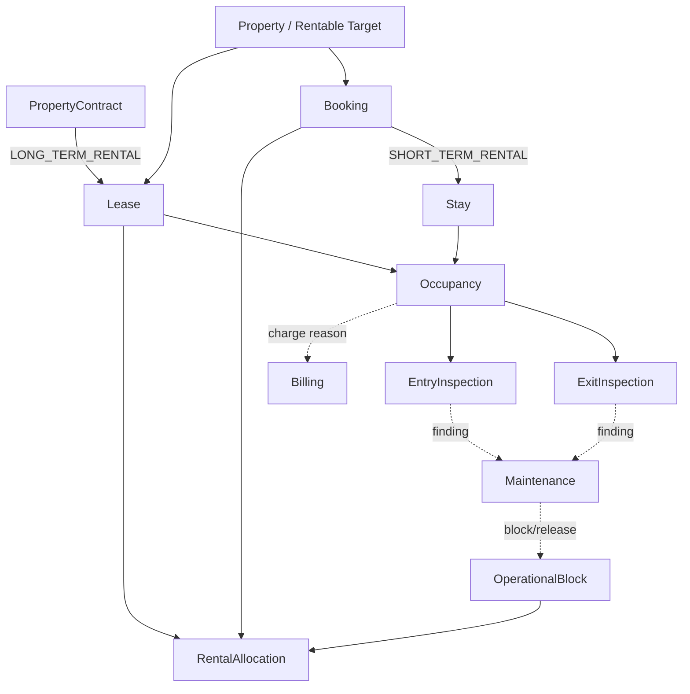

# Rental Operations

## Purpose

Rental Operations owns tenant-scoped operational execution after a rental commitment. `LONG_TERM_RENTAL` and `SHORT_TERM_RENTAL` are first-class modes.

## Ownership

Rental Operations Team owns this bounded context, its data, migrations, contracts and operational invariants.

## Implemented foundation

- `Lease` operationalizes an existing active Property `PropertyContract` without duplicating its legal lifecycle.
- `Booking` is the distinct short-term commitment; `Stay` executes a Booking.
- `Occupancy` records operational use and explicitly originates from one Lease or one Stay.
- `PropertyInspection` supports `ENTRY` and `EXIT` for both rental modes.
- `RentalAllocation` represents a temporal claim from one Lease, Booking or OperationalBlock.
- `OperationalBlock` excludes a rentable target without creating a fake Lease or Booking.
- PostgreSQL tables use `tenant_id`, tenant-scoped keys, explicit provenance constraints and forced RLS.

## Temporal availability

- Intervals are UTC half-open ranges `[start_at, end_at)`, so boundary-touching allocations do not conflict. Lease allocations may be open-ended; bookings and operational blocks must be bounded.
- `ACTIVE` allocations and blocks participate in availability. `RELEASED` records remain as history but no longer claim time.
- `OperationalBlock` is a first-class record for cleaning, maintenance, owner use, preparation, an availability-affecting inspection, renovation, administration or another explicit reason. An inspection alone does not block time.
- Availability is evaluated for a requested interval. Short-term bookings block only overlaps and never globally remove an asset from the catalog.
- An effective long-term allocation blocks incompatible intervals and yields `REMOVE_FROM_RENTAL_CATALOG`. Publication remains owned by Property Management; Rental Operations exposes the catalog disposition without mutating publication state.
- Next availability is duration-aware and scans ordered allocations for the first sufficient gap; it is not derived from the maximum end date.
- Property Management supplies tenant-validated conflict scopes. A unit claims only itself. A whole-building allocation claims the building and its rentable units, preventing building/unit overlap while leaving sibling units independent.
- Every committed allocation creates one claim per conflict scope. A PostgreSQL GiST exclusion constraint on tenant, scope and `tstzrange(..., '[)')` makes concurrent incompatible writes atomic; release updates allocation and claims in one tenant transaction.
- Claims, allocations and blocks use forced RLS. Every application query and command obtains its tenant from the trusted caller boundary and runs through a tenant-scoped transaction.

The application surface exposes check, assert, conflict-listing, next-availability and atomic allocation-commit capabilities. Rentable-target existence, hierarchy and rental eligibility remain behind the Property Management resolver port.

Catalog composition uses `GetCatalogRentalAvailability`: Property targets are resolved once per page and effective long-term occupied scopes are fetched in one tenant-scoped query. This prevents N+1 access while keeping Property publication and Rental Operations availability under their respective owners. Public transport exposes only disposition, requested-period availability and duration-aware next availability.

Maintenance may create or release explicit blocks through a future integration adapter. Billing consumes rental facts but does not decide availability. Future entry/exit inspection workflows create a block only when operational time is actually reserved.

Property identity and hierarchy remain owned by Property Management. Rentable-target and PropertyContract identifiers are validated through future explicit ports; cross-service database foreign keys are intentionally absent.

## Domain map

## Boundaries

- Property Management owns assets, hierarchy, publication, offer terms and PropertyContract.
- Billing owns invoices, receivables, payments, allocations, balances, credits and refunds.
- Maintenance owns work orders and intervention lifecycle.
- Rental Operations owns operational provenance, occupancy, inspections, allocations and blocks.
- Organization is the business boundary; Tenant is the authorization and isolation boundary.

## Deferred

- Contract-activation consumer and rentable-target validation adapter.
- Complete Booking, Stay, Occupancy and inspection workflows.
- Inspection observations, rooms, equipment, media, damages, signatures and comparisons.
- Property Management adapter for rentable-target validation, eligibility and hierarchy conflict scopes.
- Billing and Maintenance integration contracts beyond the documented event vocabulary.
- HTTP/Web surfaces, reporting, housekeeping and external booking channels.

Future allocation writes must serialize by tenant and rentable target and enforce incompatible interval exclusion transactionally. An open end is permitted only for Lease allocations. The migration establishes provenance and interval constraints without claiming to implement that concurrency policy.
